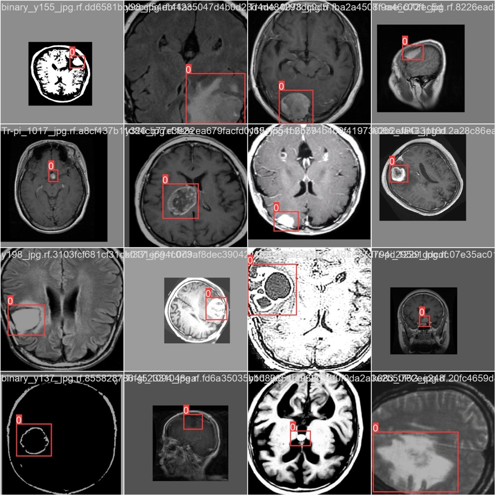
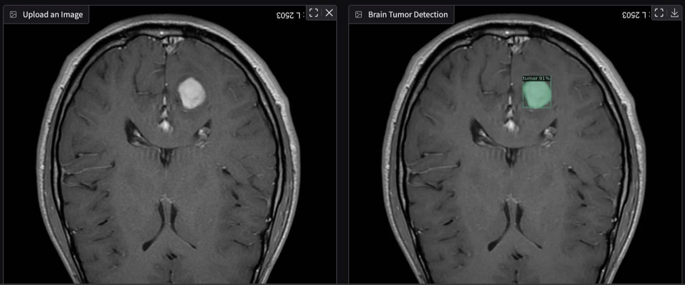
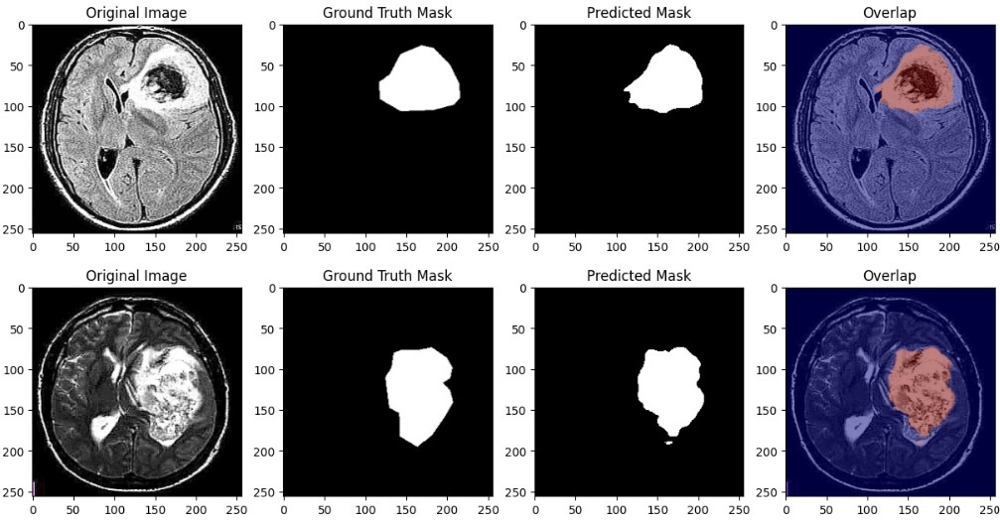

# Brain tumor detection and segmentation in MRI

**Bounding boxes, masks, and maps: YOLOv10, Mask R-CNN and U-Net on 2-D brain MRI**

Three models localize brain tumors on 2-D MRI slices, each at a finer spatial level than the last: bounding boxes (YOLOv10), per-lesion instance masks (Mask R-CNN) and a pixel-wise tumor map (U-Net). Each model is trained and evaluated on its own. For the two segmentation models we also compare optimizers.

## Data

| Task | Source | Annotation | Split |
|---|---|---|---|
| Detection | Roboflow Universe `brain-mri/mri-rskcu`, v3 (YOLO format) | boxes, 1 class | Roboflow `train` / `valid` |
| Instance and semantic segmentation | Br35H :: Brain Tumor Detection 2020 [1], `Br35H-Mask-RCNN` subset | VIA polygons and ellipses | provided `TRAIN` / `VAL` |

Br35H has 3,060 images with image-level tumor / no-tumor labels. Only the `Br35H-Mask-RCNN` subset has region annotations.

- **Mask R-CNN:** VIA regions are converted to COCO format. Polygons are kept as they are, ellipses become 20-vertex polygons, and three regions with neither shape are skipped. Detectron2 trains on 497 annotated images (561 instances) and evaluates on 240 validation instances.
- **U-Net:** polygon regions are rasterized into binary masks. Images and masks are resized to 256 × 256 and scaled to [0, 1].

## Methods

| | YOLOv10-n [2] | Mask R-CNN [3] | U-Net [5] |
|---|---|---|---|
| Implementation | [THU-MIG/yolov10](https://github.com/THU-MIG/yolov10) | Detectron2 [4] | segmentation_models_pytorch [6] |
| Backbone / initialization | `yolov10n.yaml`, random init | ResNet-50-FPN, COCO `mask_rcnn_R_50_FPN_3x` | ResNet-34 encoder, ImageNet |
| Input | 640 × 640 | shorter side 800–1024 px, horizontal flip | 256 × 256 |
| Batch | 32 images | 4 images, 128 RoIs per image | 32 images |
| Schedule | 25 epochs | 3,000 iterations, LR 2.5e-4, ×0.1 at 1,000 and 2,000 | ≤ 100 epochs, LR 1e-4, ReduceLROnPlateau (×0.5, patience 5), early stopping (patience 10) |
| Loss | CIoU + BCE + DFL | RPN + classification + box + mask BCE | BCE with logits |
| Optimizers | Ultralytics default | SGD (momentum 0.9, weight decay 1e-4); second run, see [Caveats](#caveats) | Adam (wd 1e-5), Adagrad, RMSprop (α 0.99, momentum 0.9, wd 1e-5) |
| Inference threshold | confidence 0.25 | score 0.5 | sigmoid > 0.5 |

## Results

All metrics below are on the validation split. There is no held-out test set.

### Object detection: YOLOv10-n

| mAP50 | mAP50-95 | Precision | Recall |
|:---:|:---:|:---:|:---:|
| 0.72 | 0.49 | 0.76 | 0.65 |

### Instance segmentation: Mask R-CNN (COCO AP, %)

| Run | Box AP | Box AP50 | Box AP75 | Mask AP | Mask AP50 | Mask AP75 |
|---|:---:|:---:|:---:|:---:|:---:|:---:|
| 1: SGD | 57.9 | 81.3 | 70.5 | 56.8 | 82.1 | 67.7 |
| 2: configured as Adam\* | 56.4 | 81.0 | 68.5 | 56.1 | 83.2 | 66.7 |

Over iterations 2,500–3,000, the mean total training loss is 0.430 for run 1 and 0.423 for run 2 (`metrics.json`).
\* Both runs actually used SGD; see [Caveats](#caveats).

### Semantic segmentation: U-Net

| Optimizer | Best validation BCE | Best epoch | Epochs run |
|---|:---:|:---:|:---:|
| RMSprop + momentum | 0.057 | 16 | 26 (early stop) |
| Adam | 0.099 | 64 | 74 (early stop) |
| Adagrad | 0.358 | 99 | 100 (budget) |

The report gives a mean Dice of 0.87 and an IoU of 0.79 on the validation set. The code that computes these two numbers is not in the notebook.

## Caveats

- **Mask R-CNN optimizer comparison.** Detectron2's `DefaultTrainer.build_optimizer` always builds `torch.optim.SGD` and never reads `cfg.SOLVER.OPTIMIZER` or the `ADAM_*` keys set in the notebook. Run 2 is therefore a second SGD run with momentum 0.9. Its 1.5-point gap in box AP is run-to-run variance, not an optimizer effect. A real Adam comparison needs a `DefaultTrainer` subclass that overrides `build_optimizer`.
- **Ellipse annotations in the U-Net masks.** `create_masks` rasterizes polygon regions only. A tumor annotated as an ellipse therefore gets an empty mask in the semantic-segmentation data, while the Mask R-CNN conversion keeps it.
- **Evaluation protocol.** The validation split is used both for model selection (U-Net checkpointing and early stopping) and for reporting, so the scores are optimistic. Detection uses a different dataset from segmentation, so detection and segmentation scores cannot be compared directly.
- This is research code and is not intended for clinical use.

## Reproducing

The notebooks are written for Google Colab with a GPU. They install their dependencies inline and download the data at runtime: `kagglehub` fetches Br35H, and the Roboflow API fetches the detection dataset (you need your own API key). Paths assume `/content` and a mounted Google Drive, so adjust them if you run the notebooks elsewhere.

Main dependencies: PyTorch, Ultralytics (THU-MIG/yolov10 fork), Detectron2, segmentation-models-pytorch, pycocotools, OpenCV and Gradio.

## References

1. A. Hamada. *Br35H :: Brain Tumor Detection 2020*. Kaggle. <https://www.kaggle.com/datasets/ahmedhamada0/brain-tumor-detection>
2. A. Wang et al. *YOLOv10: Real-Time End-to-End Object Detection*. NeurIPS 2024. arXiv:2405.14458
3. K. He, G. Gkioxari, P. Dollár, R. Girshick. *Mask R-CNN*. ICCV 2017.
4. Y. Wu, A. Kirillov, F. Massa, W.-Y. Lo, R. Girshick. *Detectron2*. 2019. <https://github.com/facebookresearch/detectron2>
5. O. Ronneberger, P. Fischer, T. Brox. *U-Net: Convolutional Networks for Biomedical Image Segmentation*. MICCAI 2015.
6. P. Iakubovskii. *Segmentation Models PyTorch*. 2019. <https://github.com/qubvel/segmentation_models.pytorch>
